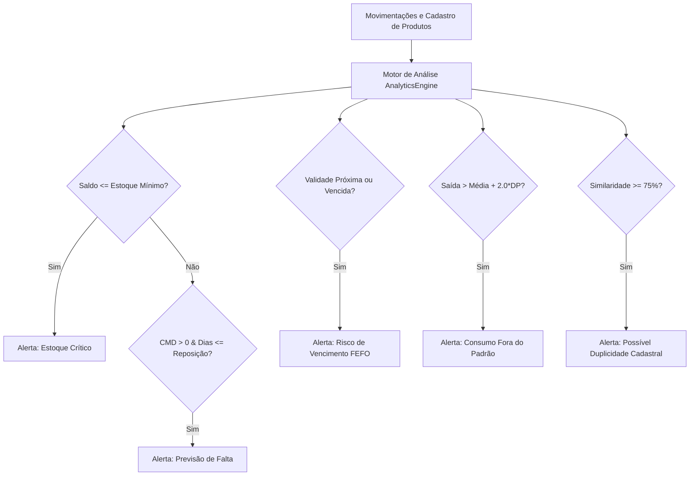

# 🌱 AgroInsight IFRO — Sistema Inteligente de Gestão de Insumos Rurais

> **AGROHACK 2026/2 — IFRO Campus Ariquemes**  
> *Transformando dados de estoque rural em inteligência agronômica preditiva, transparente e acionável.*

---

[](https://www.python.org/)
[](https://flask.palletsprojects.com/)
[](https://www.sqlite.org/)
[-success.svg?logo=checkmarx&logoColor=white)](file:///tests/test_inventory.py)
[](LICENSE)
[]()

---

## 📑 Sumário

- [a) Identificação da Equipe](#a-identificação-da-equipe)
- [b) Descrição do Problema, Público e Solução](#b-descrição-do-problema-público-e-solução)
- [c) Código-Fonte, Execução e Testes](#c-código-fonte-execução-e-testes)
- [d) Solução Funcional Acessível](#d-solução-funcional-acessível)
- [e) Vídeo Demonstrativo e Materiais](#e-vídeo-demonstrativo-e-materiais)
- [f) Dados, Tratamentos, Análises e Critérios de Alerta](#f-dados-tratamentos-análises-e-critérios-de-alerta)
- [g) Atualização de Registros e Reanálise Contínua](#g-atualização-de-registros-e-reanálise-contínua)
- [h) Testes e Evidências de Validação](#h-testes-e-evidências-de-validação)
- [i) Tecnologias, Uso de IA e Licença](#i-tecnologias-uso-de-ia-e-licença)

---

## a) Identificação da Equipe


**[Harison Manoel dos Santos Matos]** | Tecnólogo em Análise e Desenvolvimento de Sistemas — IFRO |
 **[João Marcos Ceppo Campos]** | Tecnólogo emAnálise e Desenvolvimento de Sistemas — IFRO |
 **[Lucas Manu da Silva]** | [Tecnólogo em Análise e Desenvolvimento de Sistemas] — IFRO |
 **[Wineton Jhonatan Freitas de Souza]** | [Tecnólogo em Análise e Desenvolvimento de Sistemas] — IFRO |


---

## b) Descrição do Problema, Público e Solução

### 1. O Problema
Na rotina das propriedades rurais de Rondônia e da Amazônia Ocidental, o controle de estoque de insumos ainda é frequentemente conduzido em cadernos de campo, mensagens de aplicativos ou planilhas descentralizadas. Esse formato vulnerável gera graves gargalos operacionais e financeiros:
- **Desabastecimento em momentos críticos:** Falta de defensivos, sementes ou adubos na janela exata do plantio ou do manejo fitossanitário provoca atrasos irreversíveis e perda de produtividade na safra.
- **Desperdício e perdas financeiras por vencimento:** Insumos biológicos e defensivos agrícolas de alto valor expiram no galpão sem aviso prévio, gerando prejuízo contábil e passivo ambiental de descarte.
- **Capital de giro imobilizado em excesso:** Compras desordenadas e superestimadas geram excesso de estoque, comprometendo o fluxo de caixa do produtor.
- **Vazamentos e retiradas desmedidas sem controle:** Dificuldade em identificar rapidamente desvios ou consumos atípicos de combustíveis (óleo diesel) e peças mecânicas.

### 2. O Público-Alvo
- **Produtores rurais e administradores de fazendas:** Precisam de controle rigoroso de custos e garantia de abastecimento contínuo.
- **Engenheiros Agrônomos e Técnicos Agrícolas:** Necessitam de rastreabilidade de lotes, datas de carência/validade e apoio a decisões técnicas rápidas.
- **Almoxarifes e operadores de máquinas rurais:** Precisam de interfaces simples e diretas para registrar entradas e saídas sem retrabalho.
- **Cooperativas e propriedades integradas:** Buscam padronização e relatórios estruturados para auditorias e compliance ambiental.

### 3. A Solução Desenvolvida: AgroInsight IFRO
O **AgroInsight IFRO** transcende um mero sistema de cadastro (CRUD). Ele foi concebido como um **Sistema Inteligente de Apoio à Decisão Agronômica**, baseado nos seguintes pilares:
1. **Inteligência Analítica Transparente (Explainable Analytics Engine):** O sistema não é uma "caixa preta". Cada alerta de falta, excesso ou vencimento é acompanhado pela fórmula de cálculo, pelas variáveis observadas e pela ação agronômica recomendada.
2. **Prevenção Ativa de Desabastecimento:** Cruza o ritmo recente de retiradas (Consumo Médio Diário - CMD) com o prazo de entrega cadastrado do fornecedor, antecipando o esgotamento com dias de antecedência.
3. **Gestão Inteligente de Lotes e Validades (FEFO):** Prioriza a aplicação de lotes com vencimento mais próximo (*First Expired, First Out*) e projeta a quantidade de insumo com risco de descarte caso o consumo continue no ritmo atual.
4. **Detecção Estatística de Consumo Anômalo:** Algoritmo estatístico *leave-one-out* que detecta desvios atípicos de consumo em relação ao histórico usual, prevenindo desperdícios e vazamentos.
5. **Auditoria e Reversibilidade (Transações ACID):** Bloqueio estrito de saldo negativo e rastreabilidade total de estornos com justificativa e responsável registrados.

---

## c) Código-Fonte, Execução e Testes

### Estrutura do Repositório
```text
quarto_período/
├── app.py                      # Ponto de entrada Flask, rotas e injeção de contexto global
├── requirements.txt            # Dependências oficiais (Flask 3.1.3, Jinja2, etc.)
├── agro_estoque.db             # Banco de dados SQLite persistente local
├── database/
│   ├── db.py                   # Conexão e context manager com suporte a row_factory e FKs
│   └── schema.sql              # Schema DDL (produtos, categorias, movimentações, auditoria, configurações)
├── services/
│   ├── analytics_engine.py     # Motor de cálculos explicáveis, estatísticas e projeções
│   ├── alert_service.py        # Central de ciclo de vida de alertas (Pendente, Em Acompanhamento, Resolvido)
│   ├── inventory_service.py    # Regras de negócio de estoque, bloqueio de saldo e estorno auditado
│   ├── report_service.py       # 7 relatórios completos com exportação para CSV
│   └── data_importer.py        # Carga rápida do dataset demonstrativo e importador CSV/JSON
├── seeds/
│   ├── dados_simulados.csv     # Base de dados realista de Rondônia/Ariquemes em CSV
│   └── dados_simulados.json    # Base em JSON para importação padronizada
├── templates/                  # Templates Jinja2 modernos e responsivos (Dashboard, Alertas, etc.)
├── static/                     # Folhas de estilo CSS vanilla customizadas, ícones e scripts
└── tests/
    └── test_inventory.py       # 13 testes unitários cobrindo as 12 regras do desafio
```

### Instruções de Instalação e Execução

#### 1. Pré-requisitos
- **Python 3.10 ou superior** instalado ([python.org](https://www.python.org/downloads/))
- **Git** instalado no sistema operacional

#### 2. Clonagem e Configuração do Ambiente Virtual

```bash
# Clone o repositório
git clone https://github.com/[seu-usuario-ou-organizacao]/agroinsight-ifro.git
cd agroinsight-ifro

# Criação do ambiente virtual isolado (recomendado)
python -m venv venv

# Ativação do ambiente virtual:
# No Windows (PowerShell):
.\venv\Scripts\Activate.ps1
# No Windows (CMD):
.\venv\Scripts\activate.bat
# No Linux / macOS:
source venv/bin/activate

# Instalação das dependências
pip install -r requirements.txt
```

#### 3. Execução da Aplicação

```bash
# Inicie o servidor de desenvolvimento
python app.py
```
O console exibirá:
```text
 * Running on http://127.0.0.1:5000 (Press CTRL+C to quit)
```
Abra o navegador no endereço: **[http://127.0.0.1:5000](http://127.0.0.1:5000)**.

#### 4. Carga Inicial de Dados de Demonstração
- Ao acessar a aplicação pela primeira vez, você pode clicar no botão **"Carregar Dados de Teste"** na barra superior ou navegar até **"Importação / Carga de Dados"** (`/importar`) e clicar em **"Carregar Cenários de Teste"**.
- O sistema criará automaticamente produtos e movimentações representativos de todos os cenários de alerta e auditoria.

#### 5. Execução dos Testes Automatizados

O sistema conta com suíte completa de testes unitários que executam de forma totalmente isolada em banco temporário em memória:

```bash
python -m unittest tests/test_inventory.py
```

**Resultado esperado:**
```text
.............
----------------------------------------------------------------------
Ran 13 tests in 0.413s

OK
```

---

## d) Solução Funcional Acessível

- 🌐 **Link da Aplicação Online (Produção / Demonstração):**  
- 💻 **Instruções para Avaliação Local Reproduzível:**  
  Caso a comissão avaliadora deseje testar a versão para computador:
  1. Basta descompactar o arquivo `.zip` do projeto;
  2. Executar `pip install -r requirements.txt`;
  3. Executar `python app.py`;
  4. Nenhuma dependência externa ou banco complexo (como PostgreSQL/Docker) é exigido, pois o **SQLite** e o **Python puro** garantem reprodutibilidade imediata em qualquer máquina Windows, Linux ou macOS.

---

- 📁 **Arquivos de Dados de Apoio:**  
  - Dataset de Insumos Simulados em CSV: [`seeds/dados_simulados.csv`](seeds/dados_simulados.csv)
  - Dataset de Insumos Simulados em JSON: [`seeds/dados_simulados.json`](seeds/dados_simulados.json)

---

## f) Dados, Tratamentos, Análises e Critérios de Alerta

### 1. Categorias Oficiais Suportadas
O sistema atende integralmente às 8 categorias padronizadas do regulamento:
1. `Fertilizantes` (NPK, sulfatos, cloretos, adubos foliares)
2. `Corretivos` (calcário calcítico/dolomítico, gesso agrícola)
3. `Sementes` (cultivares de soja, milho, café conilon, pastagem)
4. `Defensivos e produtos biológicos` (herbicidas, fungicidas, inoculantes)
5. `Combustíveis e lubrificantes` (diesel S10, gasolina, óleos hidráulicos)
6. `Peças e manutenção` (bicos de pulverização, correias, filtros)
7. `Materiais de irrigação` (tubos gotejadores, aspersores, conexões)
8. `Equipamentos de proteção individual e materiais diversos` (EPIs, luvas, respiradores)

### 2. Tratamento e Higienização de Dados
- **Campos Opcionais e Valores Nulos:** Dados como `preco_aquisicao_unitario` e `data_validade` são tratados como opcionais legítimos (`NULL`). O sistema **não** assume 0 para valores ausentes, evitando distorcer o cálculo de valuation financeiro do estoque ou gerar falsos alarmes de validade.
- **Normalização Textual para Duplicidades:** Nomes de produtos passam por decodificação ASCII (remoção de acentos), caixa baixa e remoção de pontuações para análise de similaridade léxica.

### 3. Fórmulas e Critérios Determinísticos do Motor de Análise



| Tipo de Análise | Natureza | Critério / Fórmula Matemática | Nível de Prioridade | Ação Recomendada |
| :--- | :--- | :--- | :--- | :--- |
| **Estoque Crítico** | Problema Confirmado | $\text{Qtd} \le \text{Estoque Mínimo}$ | **Crítico** se $\text{Qtd} \le 0.5 \times \text{Mín}$ ou $\text{Qtd}=0$; **Alto** se $\text{Qtd} \le \text{Mín}$ | Emitir pedido imediato de reposição do déficit. |
| **Previsão de Falta** | Risco Estimado | $CMD = \frac{\sum Saídas (30d)}{30}$<br>$\text{Dias} = \lfloor \frac{\text{Qtd}}{CMD} \rfloor$<br>Dispara se $\text{Dias} \le \text{Prazo Reposição}$ | **Crítico** se $\text{Dias} \le 7$ ou $\le \text{Prazo}$; **Alto** se $\le 15$; **Médio** se $\le 30$ | Programar compra antes que o prazo de entrega expire. |
| **Risco de Vencimento** | Confirmado / Estimado | $\text{Dias} = \text{Data Validade} - \text{Hoje}$<br>Calcula sobra prevista se $CMD \times \text{Dias} < \text{Qtd}$ | **Crítico** se vencido ($\text{Dias} < 0$); **Alto** se $\le 30$; **Médio** se $\le 60$ | Aplicar regra FEFO ou permutar lote com parceiros. |
| **Excesso de Estoque** | Risco Estimado | $\text{Qtd} > \text{Estoque Máximo}$ ou $\text{Qtd} \ge 3 \times \text{Mín}$ cobrindo mais de 180 dias | **Médio** (acima do teto); **Baixo** (giro lento) | Suspender novas compras e otimizar capital de giro. |
| **Consumo Anômalo** | Verificação Requerida | $\text{Saída} > \mu + (2.0 \times \sigma)$ e $\text{Saída} \ge 1.7 \times \mu$ (baseline *leave-one-out*) | **Alto** | Investigar vazamento, calibração ou desvio em campo. |
| **Deduplicação de Cadastros** | Verificação Requerida | Similaridade combinada $\ge 75\%$ via *SequenceMatcher* + *Token Sort* + *Jaccard* | **Médio** | Revisar cadastros e unificar via inventário. |
| **Variação de Preço** | Verificação Requerida | $|\Delta\%| = |\frac{P_{recente} - P_{anterior}}{P_{anterior}}| \times 100 \ge 10\%$ | **Informativo / Atenção** | Negociar com fornecedores e auditar cotações. |

### 4. Limites das Estimativas e Confiabilidade Estatística
Para assegurar a confiabilidade agronômica, o sistema **não gera previsões ilusórias** quando os dados históricos são insuficientes:
- **0 a 1 saída registrada:** Confiabilidade **Insuficiente / Baixa**. O sistema informa explicitamente: *"Histórico preliminar insuficiente para certeza estatística"* e não inventa duração em dias.
- **2 saídas:** Confiabilidade **Média**. Indica projeção baseada em amostra inicial.
- **3 ou mais saídas:** Confiabilidade **Alta**. Estatística robusta com cálculo de média e desvio padrão.

---

## g) Atualização de Registros e Reanálise Contínua

O sistema opera sob o conceito de **análise dinâmica orientada a eventos**:

```text
[Movimentação Registrada]
         │
         ▼
[Transação ACID no SQLite] ──> Validação de saldo (Bloqueio se Saldo < Saída)
         │
         ▼
[Disparo da Reanálise] ─────> Recálculo de CMD, duração, estoques e desvios
         │
         ▼
[Sincronização de Alertas] ──> Alerta crítico é automaticamente baixado/resolvido
                               após entrada de reposição suficiente
```

- **Ciclo de Resolução de Alertas:** Cada alerta gerado possui um identificador unívoco (*hash determinístico*). O gestor pode alterar o status do alerta para `Pendente`, `Em Acompanhamento` ou `Resolvido`, registrando observações e responsável.
- **Estorno Auditado com Reversão Imediata:** Caso uma movimentação de saída seja cancelada ou estornada pelo gerente, o saldo físico retorna automaticamente ao valor correto e a reanálise ajusta imediatamente os indicadores de risco, registrando a operação na tabela `movimentacoes_auditoria`.

---

## h) Testes e Evidências de Validação

### 1. Cobertura da Suíte de Testes Automatizados (`tests/test_inventory.py`)
A suíte cobre com precisão matemática as 12 regras essenciais do AGROHACK 2026/2:

| # | Teste Unitário | Regra Validada | Status |
| :---: | :--- | :--- | :---: |
| 01 | `test_01_create_and_edit_product` | Cadastro e edição com integridade referencial | ✅ Passou |
| 02 | `test_02_in_and_out_movements` | Aumento de saldo na entrada e redução na saída | ✅ Passou |
| 03 | `test_03_block_output_exceeding_stock` | **Bloqueio estrito de saída acima do saldo** (`ValueError`) | ✅ Passou |
| 04 | `test_04_critical_stock_detection` | Detecção de estoque crítico e cálculo de déficit | ✅ Passou |
| 05 | `test_05_consumption_and_stockout_forecast` | Cálculo exato de CMD e dias até desabastecimento | ✅ Passou |
| 06 | `test_06_expiration_risk` | Identificação de produto vencido e com validade próxima | ✅ Passou |
| 07 | `test_07_financial_valuation` | Valuation ignorando campos nulos sem quebrar | ✅ Passou |
| 08 | `test_08_consumption_anomalies` | Detecção de consumo atípico fora do padrão (> 2x desvio) | ✅ Passou |
| 09 | `test_09_alert_update_after_movement` | **Atualização automática de alerta após reposição** | ✅ Passou |
| 10 | `test_10_missing_optional_fields` | Tolerância estrita a campos opcionais/nulos | ✅ Passou |
| 11 | `test_11_movement_reversal_and_audit` | **Estorno com restauração de saldo e trilha de auditoria** | ✅ Passou |
| 12 | `test_12_persistence_in_sqlite` | Persistência entre conexões independentes do SQLite | ✅ Passou |
| 13 | `test_13_duplicate_product_detection` | Identificação de produtos com grafias parecidas | ✅ Passou |

### 2. O Que Funciona Perfeitamente
- ✅ CRUD completo de produtos com categorias padronizadas do regulamento.
- ✅ Registro de movimentações com bloqueio de quantidade negativa e saldo insuficiente.
- ✅ Painel de controle (Dashboard) com métricas em tempo real, atalhos rápidos e filtros.
- ✅ Central de alertas inteligente com filtros por prioridade, situação e busca textual.
- ✅ Módulo de análises explicáveis (previsão de falta, anomalias, duplicidades, capital parado).
- ✅ 7 relatórios completos com visualização em tela, layout de impressão e exportação em CSV.
- ✅ Importador de bases oficiais (CSV com delimitador `;` ou `,` e JSON) com validação de campos.
- ✅ Estorno de movimentação com registro de responsável, data e justificativa.

### 3. O Que Pode Ser Melhorado (Roadmap Futuro)
- 🔄 **Controle de Acesso Baseado em Papéis (RBAC):** Implementação de níveis de permissão (ex.: Operador registra apenas movimentações; Gerente edita cadastros e estorna).
- 📱 **Modo Offline PWA (Progressive Web App):** Aplicação mobile para operação em talhões remotos de Rondônia sem conexão celular, com sincronização em lote ao retornar ao galpão.
- 📡 **Integração com Sensores IoT:** Conexão com medidores de tanques de combustível e silos graneleiros para alimentação automática de saldo.
- 📄 **Emissão de NFP-e:** Integração com SEFIN-RO para entrada automática de insumos a partir do XML da nota fiscal do fornecedor.

---

## i) Tecnologias, Uso de IA e Licença

### 1. Tecnologias Utilizadas
- **Linguagem:** [Python 3.10+](https://www.python.org/)
- **Framework Web:** [Flask 3.1.3](https://flask.palletsprojects.com/) + Jinja2 Templates
- **Banco de Dados:** [SQLite3](https://www.sqlite.org/) com chaves estrangeiras ativas (`PRAGMA foreign_keys = ON`) e índices de busca
- **Interface e Design:** HTML5 Semântico, CSS3 Moderno (design system próprio com cores HSL agronômicas, variáveis CSS e cards responsivos), Vanilla JavaScript
- **Tipografia:** Google Fonts ([Inter](https://fonts.google.com/specimen/Inter))

### 2. Declaração de Uso Responsável de Inteligência Artificial
*(Conforme exigido pelo regulamento do AGROHACK 2026/2)*

- **Transparência e Explicabilidade (XAI):** O sistema não delega decisões críticas de compra ou descarte a modelos opacos ou geradores estocásticos que possam induzir o produtor rural ao erro. Todos os cálculos (CMD, desvio padrão, dias de cobertura, similares) utilizam **algoritmos matemáticos determinísticos e auditáveis**.
- **Assistência de IA no Desenvolvimento:** Ferramentas de IA generativa foram empregadas pela equipe estritamente como assistentes de produtividade para:
  - Estruturação do arcabouço inicial de templates e rotas;
  - Criação de massa de dados sintética realista para os cenários de teste de Rondônia;
  - Geração de casos de teste automatizados em `unittest`.
- Todas as linhas de código, fórmulas agronômicas e regras de integridade transacional foram rigorosamente revisadas, testadas e validadas pelos integrantes humanos da equipe.

### 3. Referências Técnicas
- **EMBRAPA Rondônia:** Recomendações técnicas para manejo de insumos em café conilon, pastagens e soja no bioma amazônico.
- **Regulamento Oficial AGROHACK 2026/2:** Instituto Federal de Educação, Ciência e Tecnologia de Rondônia (IFRO) — Campus Ariquemes.
- **Engenharia de Software:** *Clean Architecture* e princípios de explicabilidade em sistemas de apoio à decisão (XAI).

### 4. Licença e Condições de Uso
Este projeto é distribuído sob os termos da **Licença MIT**. É um software livre, aberto e gratuito para fins acadêmicos, comunitários e de pesquisa científica agropecuária.

```text
MIT License

Copyright (c) 2026 Equipe AgroInsight IFRO — AGROHACK 2026/2

Permission is hereby granted, free of charge, to any person obtaining a copy
of this software and associated documentation files (the "Software"), to deal
in the Software without restriction, including without limitation the rights
to use, copy, modify, merge, publish, distribute, sublicense, and/or sell
copies of the Software, and to permit persons to whom the Software is
furnished to do so, subject to the following conditions:

The above copyright notice and this permission notice shall be included in all
copies or substantial portions of the Software.
```

---

